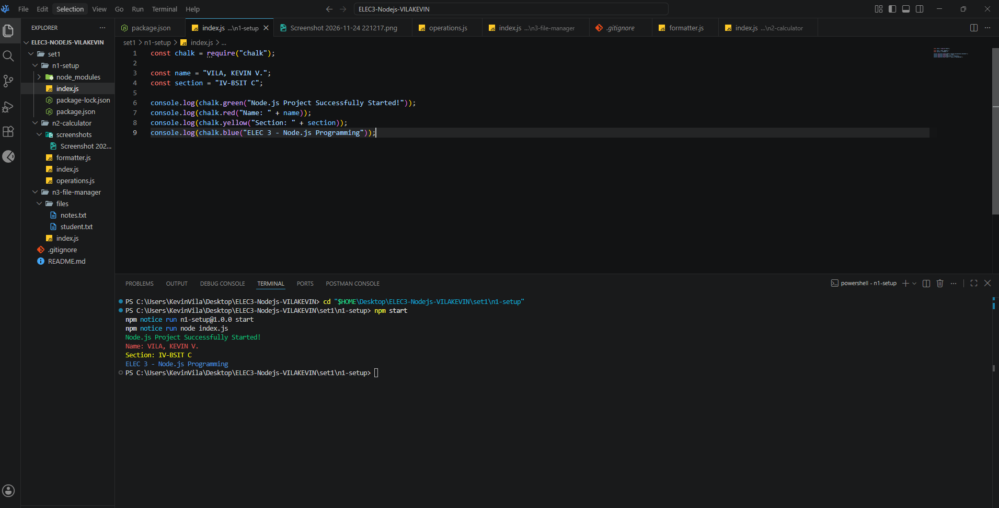
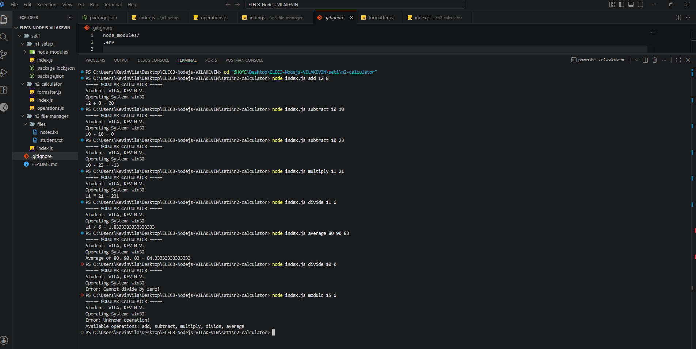
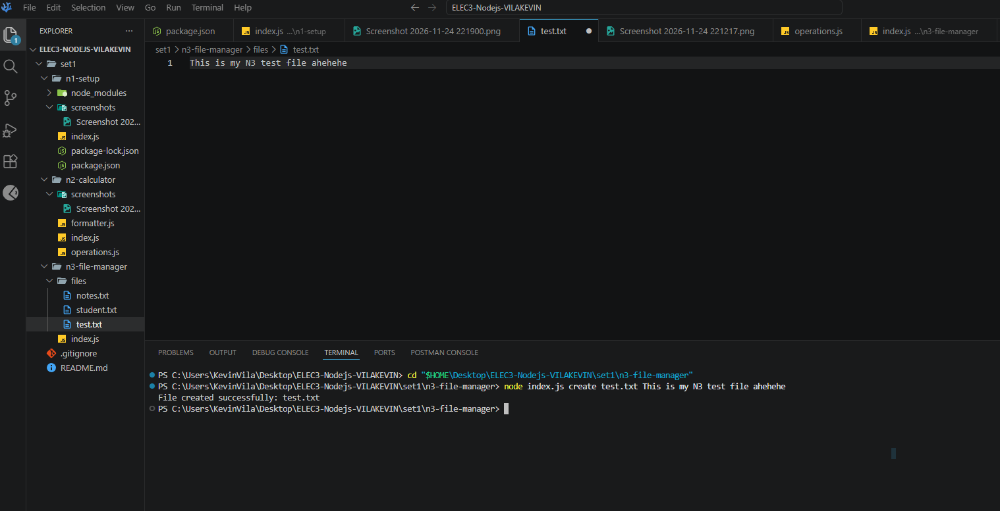

# ELEC3-NodeJS-Vila

**Full Name:** Kevin V. Vila  
**Section:** IV-BSIT C  
**Course Code:** ELEC 3 - Node.js  
**Course Title:** Node.js Programming

## Set 1 Activities

| Activity | Description | Folder |
|---|---|---|
| N1 | Node.js Setup | `set1/n1-setup` |
| N2 | Modular Calculator | `set1/n2-calculator` |
| N3 | File Manager | `set1/n3-file-manager` |

## N1 - Node.js Setup

**Description:**  
This activity demonstrates how to set up and run a basic Node.js project using npm.

**How to Run:**

```powershell
cd set1/n1-setup
npm start
```

**Example Output:**

```text
Node.js Project Successfully Started!
Name: VILA, KEVIN V.
Section: IV-BSIT C
ELEC 3 - Node.js Programming
```

**Screenshot:**



---

## N2 - Modular Calculator

**Description:**  
This activity demonstrates modular programming in Node.js by separating calculator operations and formatting into different JavaScript files.

**How to Run:**

```powershell
cd set1/n2-calculator
node index.js add 12 8
```

**Example Output:**

```text
12 + 8 = 20
```

**Other Examples:**

```powershell
node index.js subtract 12 8
node index.js multiply 12 8
node index.js divide 12 8
```

**Screenshot:**



---

## N3 - File Manager

**Description:**  
This activity demonstrates file management operations using Node.js. It allows users to create, read, update, list, and delete text files.

**How to Run:**

```powershell
cd set1/n3-file-manager
```

**Examples:**

Create a file:

```powershell
node index.js create test.txt Hello Node.js
```

Read a file:

```powershell
node index.js read test.txt
```

Update a file:

```powershell
node index.js update test.txt Updated content
```

List all files:

```powershell
node index.js list
```

Delete a file:

```powershell
node index.js delete test.txt
```

**Screenshot:**



---

## Technologies Used

- Node.js
- JavaScript
- Visual Studio Code
- PowerShell
- Git
- GitHub

## Repository Organization

The repository contains my Node.js activities and exercises for ELEC 3. Each activity is organized into its own folder with the necessary JavaScript files and screenshots.

These activities cover basic Node.js setup, modular programming, calculator operations, and file management.